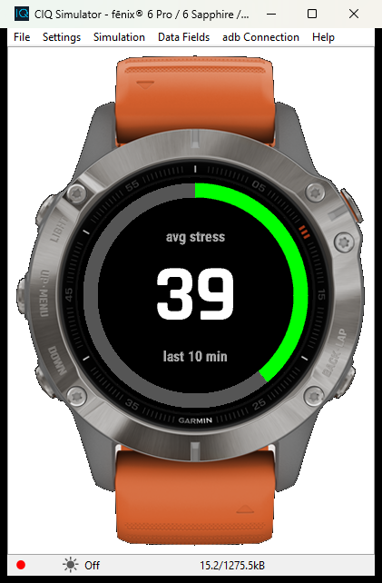
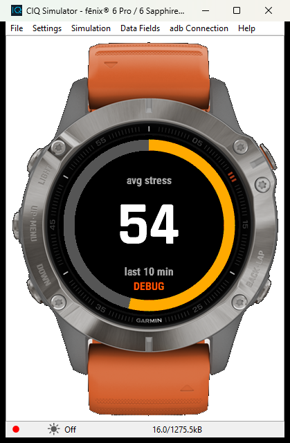
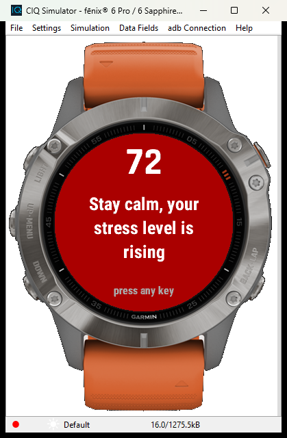

# StressGuard

App **Garmin Connect IQ** per il Fenix 6 Pro che tiene d'occhio il livello di stress e, quando la
media degli ultimi minuti supera una soglia, ti avvisa con un pop-up a schermo intero e una
vibrazione: *"Stai calmo, livello stress in aumento"*.

> Stato: **prototipo** (MVP). Progetto personale da portfolio, non pubblicato sul Connect IQ Store.

<p align="center">
  
  
  
</p>

## Funzionalità

- **Lettura dello stress** con `SensorHistory.getStressHistory()` (API 3.3+), con fallback su
  `ActivityMonitor.getInfo().stressScore` sui dispositivi che lo espongono.
- **Media mobile** sugli ultimi 10 minuti (configurabile).
- **Servizio in background ogni 5 minuti**, attivo anche ad app chiusa: se la media supera la
  soglia chiede al sistema di aprire l'app con `Background.requestApplicationWake()`.
- **Pop-up di avviso** a schermo intero con vibrazione (`Toybox.Attention`) e retroilluminazione.
- **Periodo di silenzio** tra un avviso e l'altro, rispettato anche se il pop-up viene rifiutato.
- **Schermata principale**: anello verde / giallo / rosso proporzionale allo stress e valore al centro.
- **Modalità debug** con valori di stress crescenti, per provare tutto nel simulatore.
- Testi in **italiano** e **inglese**.

## Impostazioni

Definite in `resources/settings/properties.xml`, modificabili da Garmin Connect (app installate
dallo Store) o dal simulatore.

| Impostazione | Default | Descrizione |
| --- | --- | --- |
| Soglia di stress | 70 | L'avviso scatta quando la media è **sopra** questo valore (1-100) |
| Minuti per la media | 10 | Finestra della media mobile (5-60) |
| Silenzio tra avvisi | 30 min | Tempo minimo tra due avvisi (0-240) |
| Messaggio del pop-up | *(vuoto)* | Testo personalizzato; vuoto = messaggio predefinito tradotto |
| Modalità debug | off | Sostituisce i sensori con valori simulati |

## Requisiti

- [Connect IQ SDK](https://developer.garmin.com/connect-iq/sdk/) (testato con 9.3.0) installato con
  l'SDK Manager, più il dispositivo **fenix6pro**
- Java JDK 11+ (consigliato 17)
- Facoltativo: VS Code / Cursor con l'estensione ufficiale **Monkey C**
- Una **developer key**, da tenere fuori dalla repo:

```bash
openssl genrsa -out developer_key.pem 4096
openssl pkcs8 -topk8 -inform PEM -outform DER -in developer_key.pem -out developer_key.der -nocrypt
```

(in alternativa: *Monkey C: Generate a Developer Key* dalla palette comandi dell'editor).

## Build ed esecuzione nel simulatore

```bash
# percorso dell'SDK (Windows)
SDK="$APPDATA/Garmin/ConnectIQ/Sdks/connectiq-sdk-win-<versione>/bin"

# compila
"$SDK/monkeyc.bat" -f monkey.jungle -d fenix6pro -o bin/StressGuard.prg -y /percorso/developer_key.der -w

# avvia il simulatore e carica l'app
"$SDK/connectiq.bat"
"$SDK/monkeydo.bat" bin/StressGuard.prg fenix6pro
```

Dall'editor: *Monkey C: Build for Device* e *Run* (F5) con il dispositivo fenix6pro.

**Provare l'avviso nel simulatore**

1. Nella schermata principale premi **START** (o imposta *Modalità debug* da
   *File → Edit Persistent Storage → Edit Application.Properties data*): compare il badge **DEBUG**.
2. Lo stress simulato sale di 3 punti ogni 2 secondi: entro un minuto la media supera 70 e
   si apre il pop-up con vibrazione. Qualsiasi tasto lo chiude.
3. Per il servizio in background usa *Simulation → Background Events → Temporal Event*: in debug
   il ciclo simulato va a velocità reale (la media supera 70 nei minuti 20-29 di ogni mezz'ora).
   Gli avvisi della simulazione accelerata in primo piano hanno un periodo di silenzio separato,
   quindi non bloccano quelli del background.
4. Per provarlo **ad app chiusa** (dialogo di sistema che chiede di aprire StressGuard): chiudi
   l'app con BACK, poi in *Simulation → Background Events* seleziona **StressGuard come Target
   app** prima di lanciare il Temporal Event. Senza target app il simulatore va in crash.

## Installazione sul Fenix 6 Pro (USB)

1. Compila in modalità release: aggiungi `-r` al comando `monkeyc`.
2. Collega l'orologio al PC con il cavo USB: compare come dispositivo **GARMIN**.
3. Copia `bin/StressGuard.prg` nella cartella **`GARMIN/APPS`**.
4. Scollega l'orologio: l'app compare nell'elenco delle app (tieni premuto *UP/MENU* oppure
   *START* → *App Connect IQ*, a seconda del firmware).

Nota: per le app installate via USB le impostazioni non sono modificabili da Garmin Connect;
vengono usati i valori di `properties.xml` (la modalità debug si attiva comunque con START).

## Struttura del progetto

```
manifest.xml              app, prodotto fenix6pro, permessi Background + SensorHistory
monkey.jungle             configurazione di build
resources/
  strings/strings.xml     testi italiani (default)
  settings/               properties.xml (default) e settings.xml (Garmin Connect)
  drawables/              icona del launcher 40x40
resources-eng/strings/    testi inglesi
source/
  StressGuardApp.mc       entry point, registra il background, gestisce gli avvisi
  StressMonitor.mc        lettura dello stress, media, simulazione debug
  AlertEngine.mc          soglia, silenzio, impostazioni
  BackgroundService.mc    servizio eseguito ogni 5 minuti
  views/MainView.mc       anello e valore dello stress
  views/AlertView.mc      pop-up "Stai calmo" con vibrazione
  delegates/              gestione dei tasti
```

## Limiti noti

- Il background gira al massimo ogni 5 minuti: intercetta lo stress che sale e persiste, non lo
  scatto istantaneo. Con l'app aperta il controllo avviene ogni 30 secondi.
- Lo stress Garmin si basa sull'HRV: caffè, caldo o scale lo alzano come un'arrabbiatura.
- Il servizio in background ha 32 KB di memoria: il suo codice resta essenziale.

## Roadmap

- [x] MVP: lettura stress, soglia, pop-up con vibrazione, test nel simulatore
- [x] Servizio in background, impostazioni, periodo di silenzio
- [ ] Notifica allo smartphone (ntfy / Telegram) via `makeWebRequest`
- [ ] Respirazione guidata dal pop-up e storico degli episodi
- [ ] Rilevamento della salita rapida, filtro durante lo sport, modalità "situazione delicata"
- [ ] Glance / widget, test sul Fenix 6 Pro reale

## Licenza

Progetto personale; licenza da definire.
